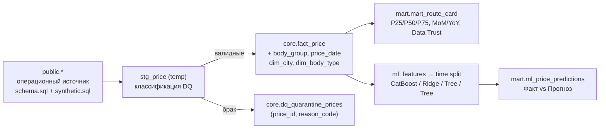
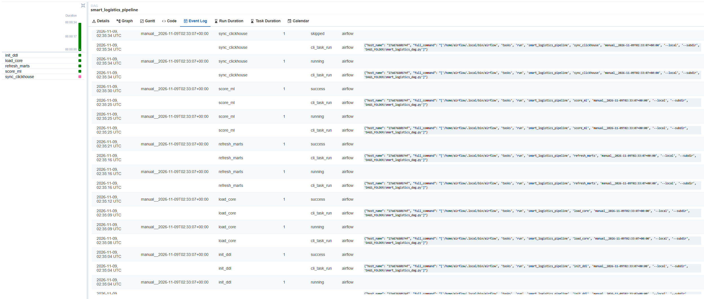

# Smart Logistics Data & ML Platform

Тестовое задание на очистку и загрузку сделок, витрина рыночного коридора ставок, ML-прогноз тарифа с пакетным скорингом.

## Запуск

```bash
docker-compose up       
```

Поднимается PostgreSQL 17, генерируется источник (300 000 сделок), затем отрабатывают ETL → витрины → обучение и скоринг. Итоговые метрики лежат в `artifacts/metrics.json`, прогнозы в `mart.ml_price_predictions`.

## Архитектура



| Слой | Схема | Что внутри |
| :--- | :--- | :--- |
| Источник (raw) | `public` | Операционные таблицы из `sql/schema.sql`, не изменяются. Отдельной копии raw нет: источник и DWH в одном инстансе, ELT читает источник напрямую. |
| Core | `core` | `fact_price` (очищенные сделки, `price_rub`), `fact_price_body_group`, `fact_price_date`, справочники `dim_city`, `dim_body_type`, карантин `dq_quarantine_prices`, журнал `etl_run_log`. |
| Mart | `mart` | `mart_route_card`, представление `v_route_latest`, `ml_price_predictions`, `ml_model_metrics`. |

## Стек

* **PostgreSQL 17** для всех слоёв: объёмы задания (сотни тысяч строк) не оправдывают отдельной аналитической СУБД, а `percentile_cont`, `FILTER`, `DISTINCT ON` и `LATERAL` закрывают всю аналитику. ClickHouse имеет смысл при десятках миллионов строк и высоком QPS от BI.
* **ELT: Оркестрация в Python, обработка данных в SQL.** Фильтры, конвертация валют, дедупликация и агрегаты выполняются внутри БД одним проходом, без построчных `INSERT` в Python. Единственная запись из Python-памяти (прогнозы) идёт через `COPY`.
* **Оркестрация:** основной путь это CLI (`python -m etl.pipeline`), а Airflow-DAG из extra вызывает те же команды, поэтому результаты идентичны (см. раздел Extra).
* **ML: CatBoost** как основная модель (нативные категории, не требует масштабирования, лучшая по R&D-отчёту), **Ridge** (линейный) и **DecisionTree** как два бейзлайна для сравнения, как в R&D-отчёте.

## Запуск

```bash
cp .env.example .env     # необязательно: есть значения по умолчанию
docker-compose up
```

Порядок: `postgres` (healthcheck) → `source-init` (`schema.sql` + `synthetic.sql` одной транзакцией, повторно не выполняется) → `pipeline` (`etl.pipeline all`, затем `ml.train_score`). Данные Postgres лежат в томе `pgdata`; `docker-compose down -v` сбрасывает всё. Порт БД опубликован только на `127.0.0.1:55432` (нестандартный, чтобы не конфликтовать с локальным Postgres): `psql -h 127.0.0.1 -p 55432 -U postgres deals_bigdata`. Версии зависимостей закреплены в `requirements.txt`.

**Параллельные запуски.** Любая команда пайплайна и ML-скоринг берут сессионный advisory lock; второй запуск сразу завершается с кодом 2 и сообщением в логе. Блокировка снимается вместе с соединением.

Переменные окружения описаны в `.env.example`. `AS_OF=2026-10-26` задаёт дату снимка, **системная дата нигде не используется**.

### Повторный запуск и Backfill

Окно задаётся по `prices.loading_date`, обе границы включительно; пересчёт окна атомарен (`DELETE` + `INSERT` в одной транзакции), поэтому повтор не создаёт дублей. Если сделка пришла в окно с изменённой датой погрузки, её старая копия (по `price_id`) в Core и карантине тоже заменяется.

```bash
# перезагрузить сентябрь 2026 в Core
docker-compose run --rm pipeline python -m etl.pipeline core --start-date 2026-09-01 --end-date 2026-09-30
# пересчитать витрины и прогнозы
docker-compose run --rm pipeline python -m etl.pipeline marts
docker-compose run --rm pipeline python -m ml.train_score
# для Airflow: logical_date -> --start-date {{ ds }} --end-date {{ ds }}
```

Витрина `mart_route_card` пересобирается целиком от Core в одной транзакции (читатели BI видят старую или новую версию, не промежуточную): MoM/YoY зависят от соседних месяцев. При росте данных пересчёт стоит ограничить затронутыми месяцами плюс 12 предыдущих.

## Data Quality (Вопрос 1)

Правила применяются к строкам окна в `stg_price`; брак пишется в `core.dq_quarantine_prices` (по строке на каждую причину), статистика отсева логируется и сохраняется в `core.etl_run_log`.

| `reason_code` | Условие |
| :--- | :--- |
| `NON_FINITE_VALUE` | `NaN` / `±Infinity` в `price`, `distance`, `total_weight`, `total_volume` (в PostgreSQL `NaN` больше любого числа и иначе прошёл бы проверку `price > 0`) |
| `PRICE_NON_POSITIVE` | `price <= 0` |
| `RUB_PRICE_LE_1000` | валюта `643` и `0 < price <= 1000` |
| `DISTANCE_NON_POSITIVE` | `distance <= 0` |
| `NEGATIVE_WEIGHT` / `NEGATIVE_VOLUME` | `total_weight < 0` / `total_volume < 0` |
| `LOADING_CITY_NOT_FOUND` / `UNLOADING_CITY_NOT_FOUND` | `gc_id` отсутствует в `cities` |
| `UNSUPPORTED_CURRENCY` | валюта вне `643/840/978` |
| `FX_RATE_DATE_MISSING` | `840/978` и `nearest_rate_date IS NULL` |
| `FX_RATE_NOT_FOUND` | `840/978`, дата есть, но точного курса на неё нет (или курс нулевой / нефинитный) |

На сгенерированных данных правило `RUB_PRICE_LE_1000` само не срабатывает: все рублёвые ставки до 1000 равны нулю и получают `PRICE_NON_POSITIVE` (поэтому причины в карантине не пересекаются: 164 + 39 = 203 уникальные сделки). Правило остаётся защитой для реальных данных.

Сделки с `loading_city_gcid = unloading_city_gcid` **не отбраковываются**, как и сказано в задании.

**Конвертация:** `price_rub = round(price * rate, 2)`, курс берётся точным совпадением `(currency_code, nearest_rate_date)`, без fallback на `loading_date`. Цены считаются без НДС.

**Категории:** пропуски `weight_category` заполняются по весу, округлённому до 0.1 т (`G20T ≥ 30`, `FTL [10;30)`, `10T [5;10)`, `5T [2.5;5)`, `L5T [0.5;2.5)`, иначе `OTH`); `volume_category` = `FTL` при `0 < V ≤ 120`, иначе `OTH`. Заполненные в источнике значения не перезаписываются.

**Выбросы:** используется входной флаг `outlier_mark`, пересчёт не делался.

> **Ограничение исходных данных.** Сделки, созданные 2026-10-26 после 02:30, ещё не прошли ночную разметку и имеют `outlier_mark = false` по умолчанию. В Core они попадают как «чистые», хотя среди них есть настоящие выбросы. Эффект: в витрине последний день снимка слегка искажён, а в ML-тесте на `as_of` могут оказаться неразмеченные выбросы. Сколько их, по данным определить нельзя: в `metrics.json` поле `test_rows_on_as_of_day` показывает лишь число test-строк этого дня (верхнюю границу доли, которой коснулась проблема), а не число выбросов. Дополнительно выбросы не пересчитывались.

### Допущения, которые стоит знать

1. **`RUB_PRICE_LE_1000`.** Формулировка задания «для RUB также source-validation диапазон `price <= 1000`» прочитана как «рублёвые ставки ≤ 1000 невалидны». Порог зашит в блоке `core_stage` файла `sql/dwh.sql`.
2. **Окно ETL по `loading_date`.** Старая копия переехавшей сделки заменяется, если загружается окно, куда она пришла. Если же окно загружают с **прежней** датой и сделка из него ушла, строка исчезнет только при загрузке окна с новой датой (или полной); это обычный snapshot/backfill-подход без CDC.
3. **Сделки без `price_dates`** в витрину не попадут (месяц строится только по `price_dates`); их число логируется как `loaded_without_price_dates`.

## Витрина «Карточка маршрута» (Вопрос 2)

`mart.mart_route_card`, grain: `price_month × loading_city_gcid × unloading_city_gcid × body_group × weight_category`. Эталонный запрос: [`sql/route_card.sql`](sql/route_card.sql).

* **Месяц** строится по `price_dates.price_date`, а не по `loading_date`; плановые даты `> as_of` исключены. Одна долгосрочная заявка попадает в несколько месяцев, внутри месяца считается один раз.
* **Выборка:** `is_fact`, `price_type IN (1,2,3,4,5,9)`, `NOT complex`, `NOT outlier_mark`, `price_rub > 0`, `distance > 0`.
* **Дедупликация:** города по минимальному `cities.id` на `gc_id`; кузова: одна цена даёт ровно одну строку на группу (`Тент / Рефрижератор / Изотерм / Борт / Прочие`), без связи в `price_body_types` fallback на `prices.body_type`, затем `Не указан`. Цена с двумя типами кузова из разных групп попадает в обе группы, это следует из требований.
* **Метрики:** `p25/median/p75/avg` за рейс и `p25/median/p75` за км (`percentile_cont`, в один проход на массив долей), `trips_count`, `carriers_count` (`price_type IN (3,9)`), `cv_rate` (`NULL` при менее двух наблюдений), `mom_pct`/`yoy_pct` по `median_trip` (+ `mom_km_pct`/`yoy_km_pct`), `reliability_level`.
* **MoM/YoY** считаются только по календарно соседней ячейке того же маршрута; если её нет или медиана нулевая, значение `NULL`, «последний доступный месяц» не подставляется.
* **`reliability_level` и свежесть.** `HIGH` требует `trips_count ≥ 30`, `carriers_count ≥ 5` и `as_of − last_price_date ≤ 30` дней, где `last_price_date` это последняя дата данных **в самой ячейке** (колонка есть в витрине). Следствие: исторические месяцы не бывают `HIGH`, максимум `MEDIUM`. Если по замыслу свежесть должна считаться по маршруту в целом, меняется одно условие.
* `volume_category` в витрину не вынесена: в grain она не входит, а выбор «представительного» значения для ячейки был бы произвольным.
* `mart.v_route_latest` отдаёт последний месяц по каждой ячейке для сводной таблицы сети.

Примеры проверочных запросов: блок `checks` в [`sql/dwh.sql`](sql/dwh.sql).

## ML (Вопрос 3)

Код: `ml/features.py` (признаки, защита от утечек, хронологические окна) и `ml/train_score.py` (модели, метрики, обучение, скоринг, запись результатов).

* **Таргет:** `price_rub` фактических прямых сделок (`is_fact`, `NOT complex`), очистка по входному `outlier_mark` (сам флаг не признак). Выборка ML даёт одну строку на сделку.
* **Признаки:** `distance`, `total_weight`, `total_volume`, регион отправления и назначения, координаты обоих городов, набор групп кузова сделки как одна категория (например, `Борт + Тент`: сделка не размножается и согласована с витриной), `weight_category`, `volume_category`, `year` и sin/cos месяца (T=12), дня недели (T=7), дня года (T=365.25). Регион извлекается в Core из `full_name_local` по дедуплицированному справочнику городов.
* **Защита от утечек:** `price_with_vat`, удельные ставки, маржа/`carrier_cost` и вся `price_group_stats` в Core не попадают, а `build_features` дополнительно падает с ошибкой при появлении колонки, похожей на производную таргета (`assert_no_leakage`, тесты в `tests/test_features.py`).
* **Time split от `as_of`, не от системной даты:** `train = [2026-07-26, 2026-10-05)`, `test = [2026-10-05, 2026-10-26]`, граница 10-05 только в test, `shuffle` нигде нет. Для ранней остановки CatBoost последние 14 дней train (`[2026-09-21, 2026-10-05)`) используются как валидация, это подмножество train. Все трансформеры (импутер, энкодеры, скейлер) обучаются только на части train.
* **Скоринг:** очищенные фактические сделки test-периода (на них же считаются метрики) и **все** плановые заявки `loading_date > as_of` с валидными данными и прямым маршрутом, независимо от `is_fact` (включая ставки торгов) и от того, заполнена ли в источнике цена. Для плановых `actual_price_rub`, `abs_error_rub`, `ape_pct` всегда `NULL`. Размеченные выбросы в прогнозы test не попадают. Это осознанный выбор: плановых заявок со ставками торгов (`price_type = 6`) в источнике 929, поэтому с ними будущих строк 5 820, а только с фактами 4 891; колонка `is_fact` позволяет получить любой вариант одним фильтром. На уровне БД `CHECK` запрещает записать факт и ошибки для `split = 'future'`.
* **Воспроизводимость:** `random_seed` (по умолчанию 42) передаётся во все модели, зависимости закреплены, нативный файл CatBoost сохраняется в `artifacts/models/`.

**Ограничения модели.** Train покрывает около трёх месяцев, поэтому сезонные признаки (месяц, день года) видят только август–октябрь, а плановые заявки уходят до февраля 2027. Деревья не экстраполируют, и сезонный пик ноября–декабря модель не воспроизведёт: прогнозы на будущее надо читать как «уровень конца train-периода с поправкой на маршрут». `year` внутри train константа, признак заработает при более длинной истории.

### Метрики на test

Результат прогона на 300 000 сделок (`as_of = 2026-10-26`, seed 42): train 24 226, test 12 808 (очищенные факты), плановых заявок 5 820, всего прогнозов 18 628. Актуальные значения каждого запуска: `artifacts/metrics.json` и `mart.ml_model_metrics`.

| Модель              |   R²   | MAPE, % | RMSE, руб. | MAE, руб. |
| :------------------ | :----: | :-----: | ---------: | --------: |
| CatBoost (основная) | 0.9202 |  15.54  |     54 042 |    28 203 |
| Ridge               | 0.8475 |  36.28  |     74 715 |    45 010 |
| DecisionTree        | 0.9012 |  16.65  |     60 144 |    31 662 |

Параметры и важность признаков каждой модели сохраняются в `mart.ml_model_metrics` (колонки `params`, `feature_importance`) и в `artifacts/metrics.json`.

CatBoost почти вдвое точнее линейного бейзлайна по MAPE: тариф нелинейно зависит от взаимодействия расстояния, веса и кузова, что Ridge не улавливает. Одиночное дерево (R² 0.90) близко к ансамблю по относительной ошибке, но заметно уступает по RMSE (60 тыс. против 54 тыс. руб.): ансамбль лучше справляется с крупными промахами на дальних рейсах. Для сравнения, R&D-отчёт даёт ориентир R² ≈ 0.93 и MAPE ≈ 13% на других данных.

## Проверка результата

Все команды выполняются из корня репозитория (PowerShell и bash) после `docker compose up --build`. Контейнер `postgres` должен работать (`docker compose up -d --wait postgres`).

**1. Лог запуска.** В конце вывода `pipeline` должны быть: `core load finished ... read=300000 loaded=299797 quarantined=203`, `mart refresh finished rows=203644`, три строки `model=... test R2=...` и `pipeline-1 exited with code 0`.

**2. Контрольные цифры.**

```bash
docker compose exec -T postgres psql -U postgres -d deals_bigdata -c "
SELECT (SELECT count(*) FROM core.fact_price)                                         AS core_rows,
       (SELECT count(DISTINCT price_id) FROM core.dq_quarantine_prices)               AS quarantined,
       (SELECT count(*) FROM mart.mart_route_card)                                    AS mart_cells,
       (SELECT count(*) FROM mart.ml_price_predictions WHERE split='test')            AS pred_test,
       (SELECT count(*) FROM mart.ml_price_predictions WHERE split='future')          AS pred_future,
       (SELECT count(*) FROM mart.ml_price_predictions WHERE split='future' AND is_fact) AS pred_future_fact;"
```

| `core_rows` | `quarantined` | `mart_cells` | `pred_test` | `pred_future` | `pred_future_fact` |
| ---: | ---: | ---: | ---: | ---: | ---: |
| 299797 | 203 | 203644 | 12808 | 5820 | 4891 |

Баланс: `299 797 + 203 = 300 000` строк источника. Причины карантина: `PRICE_NON_POSITIVE` 164 и `FX_RATE_DATE_MISSING` 39 (`SELECT reason_code, count(*) FROM core.dq_quarantine_prices GROUP BY 1`).

**3. Метрики моделей** (`as_of = 2026-10-26`, seed 42, воспроизводятся от запуска к запуску):

```bash
docker compose exec -T postgres psql -U postgres -d deals_bigdata -c "SELECT model_name, round(r2::numeric,4) r2, round(mape_pct::numeric,2) mape, round(rmse_rub::numeric) rmse, round(mae_rub::numeric) mae, n_train, n_test FROM mart.ml_model_metrics ORDER BY r2 DESC;"
```

Ожидаемо: `catboost` 0.9202 / 15.54, `tree` 0.9012 / 16.65, `ridge` 0.8475 / 36.28; `n_train = 24226`, `n_test = 12808`. Те же числа лежат в `artifacts/metrics.json`.

**4. Прогнозы корректны.** У плановых заявок нет факта, а ошибки на test считаются только по очищенным фактам:

```bash
docker compose exec -T postgres psql -U postgres -d deals_bigdata -c "SELECT split, count(*) n, count(actual_price_rub) with_actual, round(avg(ape_pct)::numeric,2) mape FROM mart.ml_price_predictions GROUP BY 1;"
```

Для `future` колонка `with_actual` равна 0 (и `CHECK` в таблице не даст записать иначе), для `test` равна `n`.

**5. Идемпотентность.** Повторный запуск и перезагрузка окна не меняют числа из пункта 2:

```bash
docker compose run --rm --no-deps pipeline python -m etl.pipeline core --start-date 2026-09-01 --end-date 2026-09-30
docker compose run --rm --no-deps pipeline python -m etl.pipeline marts
```

После них снова выполните запрос из пункта 2: значения те же. То же проверяют тесты (по `md5` содержимого слоёв).

**6. Тесты.**

```bash
docker compose run --rm --no-deps pipeline pytest -m "not db"      # без БД
docker compose run --rm --no-deps pipeline pytest -m db -rs         # на данных (БД должна быть запущена)
```


**7. Типичные проблемы.**

| Симптом | Причина и решение |
| :--- | :--- |
| `Неизвестная модель 'tree'`, старые строки лога | Образ не пересобран после обновления кода: `docker compose up --build` |
| `ports are not available` | Порт хоста занят: задайте другой через `PG_PORT`, `CLICKHOUSE_HTTP_PORT`, `AIRFLOW_PORT`, `SUPERSET_PORT` |
| `TLS handshake timeout` при сборке | Нет связи с Docker Hub; повторить или сменить сеть/VPN |
| `Name or service not known` у `clickhouse-sync` | ClickHouse не запущен: `docker compose --profile clickhouse up -d --wait clickhouse` |
| Все БД-тесты пропущены | Не запущен `postgres` (см. пункт 6) |

## Extra: Airflow, ClickHouse, Superset

Extra-компоненты подключаются **профилями Compose**: базовый `docker-compose up` их не запускает и работает как раньше. PostgreSQL остаётся источником истины, результаты пайплайна от extra-компонентов не меняются.

```bash
docker-compose --profile clickhouse up   # + ClickHouse, перенос витрин
docker-compose --profile airflow up      # + Airflow, UI http://127.0.0.1:18080 (admin / admin)
docker-compose --profile superset up     # + Superset с готовым дашбордом, UI http://127.0.0.1:18088 (admin / admin)
docker-compose --profile extra up        # всё вместе
```

**Airflow** (`extra/airflow_dag.py`): DAG `smart_logistics_pipeline` с цепочкой `init_ddl → load_core → refresh_marts → score_ml → sync_clickhouse`. Каждая задача вызывает тот же CLI, что и обычный запуск, в отдельном виртуальном окружении (`extra/Dockerfile.airflow`), чтобы зависимости проекта не конфликтовали с Airflow. `max_active_runs=1` и advisory lock в БД исключают пересечение запусков. Расписания нет (`schedule=None`): снимок данных зафиксирован на `as_of`, поэтому запуск ручной; backfill окна:

```bash
docker-compose exec airflow airflow dags trigger smart_logistics_pipeline \
    --conf '{"start_date": "2026-09-01", "end_date": "2026-09-30"}'
```

Параметры окна проверяются регулярным выражением даты, так как попадают в bash-команду. Для боевого расписания достаточно `schedule="@daily"` и подстановки `{{ ds }}` в окно. Задача `sync_clickhouse` пропускается (код выхода 99), пока не задано `ENABLE_CLICKHOUSE_SYNC=1`.

**ClickHouse** (`extra/clickhouse_sync.py`, DDL в `sql/clickhouse.sql`): `mart_route_card` и `ml_price_predictions` переносятся в `ReplacingMergeTree` (ключ сортировки = grain витрины). Выгрузка идёт одним `COPY ... TO STDOUT` в CSV и заливкой по HTTP-интерфейсу, без дополнительных библиотек. Идемпотентность: данные льются в `<таблица>__new`, число строк сверяется с PostgreSQL, затем атомарный `EXCHANGE TABLES`; при расхождении подмена не происходит. Для точных чисел до слияния кусков читать нужно с `FINAL`:

```bash
docker-compose exec clickhouse clickhouse-client --user analytics --password analytics \
    -q "SELECT reliability_level, count() FROM analytics.mart_route_card FINAL GROUP BY 1"
```

**Superset** (`extra/Dockerfile.superset`, `extra/superset_bootstrap.py`): образ добавляет драйвер PostgreSQL. Одноразовый контейнер `superset-init` готовит метаданные и **изнутри Superset** создаёт подключение к DWH, шесть датасетов (витрины `mart.*` и карантин `core.dq_quarantine_prices`) и дашборд «Тарифный мониторинг: рынок и точность прогноза». Что на нём:

* четыре показателя вверху: ошибка прогноза (MAPE), R², число ячеек сети с высокой надёжностью данных и число строк в карантине;
* обзор сети: таблица актуального среза по каждой ячейке и круговая диаграмма надёжности;
* разбор маршрута: диапазон цены рейса и цены за километр (P25, медиана, P75) во времени и помесячная таблица с показателями надёжности; управляется фильтрами «Пункт погрузки / Пункт выгрузки / Тип кузова / Весовой класс» (по умолчанию Москва → Казань, тент, FTL), которые действуют только на эти три графика;
* контроль модели: фактическая и прогнозная цена по дням погрузки, рейсы отложенного периода, где факт превысил прогноз не менее чем на 30 процентов, и причины попадания строк в карантин.

Скрипт идемпотентен: при повторном запуске дашборд и его графики пересоздаются из кода.

**Проверка extra-компонентов**

* **ClickHouse:** после `docker compose --profile clickhouse up --build clickhouse clickhouse-sync` (если порт хоста занят, задайте `CLICKHOUSE_HTTP_PORT`):

  ```bash
  docker compose exec clickhouse clickhouse-client --user analytics --password analytics -q "SELECT count() FROM analytics.mart_route_card FINAL"
  docker compose exec clickhouse clickhouse-client --user analytics --password analytics -q "SELECT split, count() FROM analytics.ml_price_predictions FINAL GROUP BY split"
  ```

  Ожидаемо 203 644, а также `test 12808` и `future 5820`. Повторный запуск `clickhouse-sync` не меняет эти числа.
* **Airflow:** после `docker compose --profile airflow up --build airflow` откройте UI (по умолчанию `127.0.0.1:18080`), запустите DAG `smart_logistics_pipeline`. Ожидаемо: `init_ddl`, `load_core`, `refresh_marts`, `score_ml` успешны, `sync_clickhouse` пропущена.
* **Superset:** после `docker compose --profile superset up --build` в логе `superset-init` строка `dashboard ... 12 charts, 6 datasets`, затем дашборд на `127.0.0.1:18088`: верхние показатели (MAPE 15.54, R² 0.920, карантин 203), фильтры «Пункт погрузки / Пункт выгрузки / Тип кузова / Весовой класс» меняют три графика разбора маршрута.

Результаты запусков:



![[docs/superset.png]]


## Структура репозитория

```
docker-compose.yml, Dockerfile, .env.example, requirements.txt, pytest.ini
sql/schema.sql, sql/synthetic.sql   источник (без изменений)
sql/dwh.sql                         DDL core/mart/ml и ELT-шаги: именованные блоки `-- @@ <имя>`
sql/route_card.sql                  эталонный запрос витрины маршрута
sql/clickhouse.sql                  DDL таблиц ClickHouse (extra)
sql/init_source.sh                  инициализация источника в compose
etl/db.py                           настройки, соединения, SQL-блоки, COPY, advisory lock
etl/pipeline.py                     CLI: init / core / marts / all
ml/features.py                      признаки, защита от утечек, временные окна
ml/train_score.py                   модели (CatBoost, Ridge, DecisionTree), метрики, обучение, скоринг
extra/                              Airflow-DAG, перенос в ClickHouse, Superset (+ Dockerfile'ы)
tests/test_dq.py                    DQ, Core, идемпотентность, витрина и pandas-оракул, прогнозы
tests/test_ml.py                    признаки, утечки, split, метрики, обучение и скоринг
tests/test_extra.py                 ClickHouse, дашборд Superset, DAG
docs/                               скриншоты живых запусков (Airflow, Superset)
```

